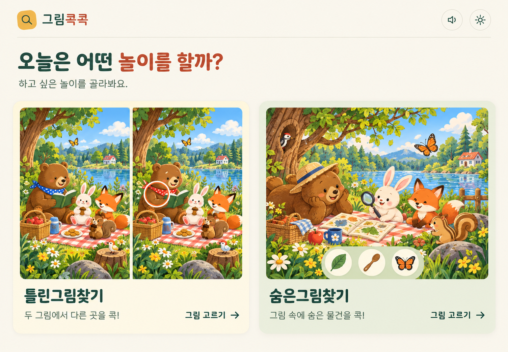
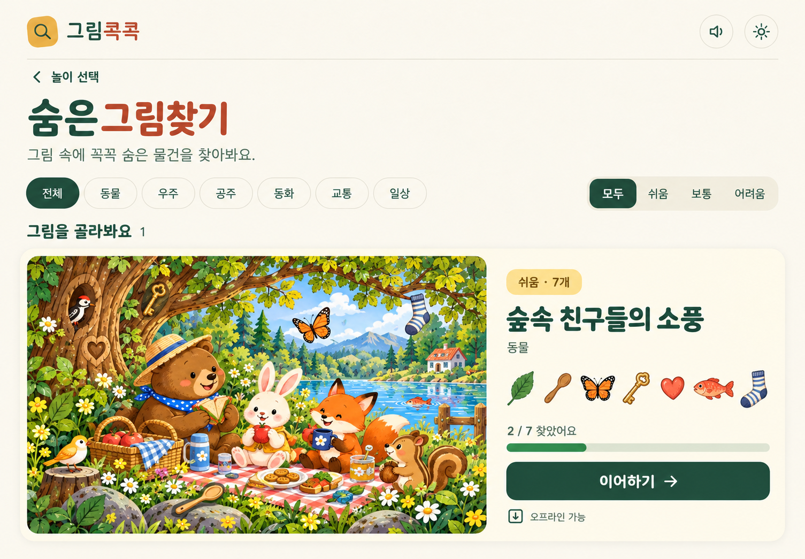
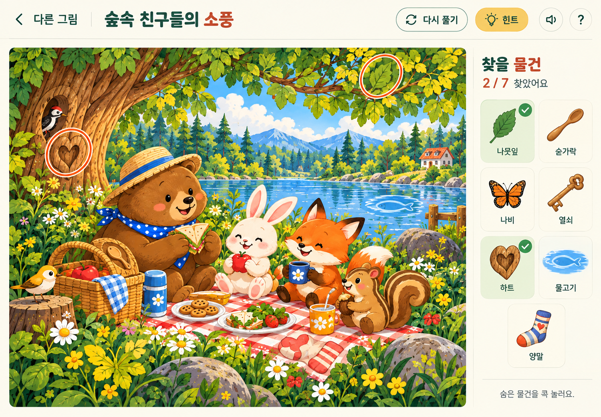

# 숨은그림찾기 화면 시안

2026-10-29 · 사용자 승인 · 앱 구현 진행

기존 그림콕콕의 색·둥근 글꼴·그림 중심 화면을 유지한다. 놀이 선택에서 종류를 고른 뒤 해당 목록과 플레이로 이동한다. 후속 요청에 따라 실제 숨은그림 콘텐츠는 30개로 확장한다.

## 놀이 선택

두 놀이를 같은 크기의 그림으로 구분한다. 선택 영역 전체를 눌러 각 목록으로 이동한다.

## 숨은그림 목록

시범 한 장만 표시한다. 장면과 목표 물건 예시, 난이도와 진행 상태를 함께 보여준다. 시안의 진행 개수와 오프라인 표시는 예시다.

## 숨은그림 플레이

iPad 가로 화면은 큰 그림 왼쪽·찾을 물건 오른쪽으로 구성한다. 찾은 항목에 체크하고 본그림에 정답 표시를 남긴다. 목표 그림 목록은 확대·이동과 별도로 고정한다. 세로 화면에서는 목표 목록을 아래로 옮긴다.

## 검토 범위와 한계

화면 시안은 내장 `image_gen`으로 생성했다. 한국어 문구와 구성은 시각적으로 확인한다. 게임 그림은 배치 예시이며 목표 일치·정답 영역·난이도를 검증한 콘텐츠가 아니다. 실제 게임 제작 시 숨길 대상을 먼저 계획하고 최종 장면·목표 그림·판정 영역을 검수한다. 생성 시안의 글자 크기와 도구 위치는 실제 화면 크기로 구현하면서 조정한다.

이번 작업에서는 앱 코드와 콘텐츠 등록을 변경하지 않았다. 공개 배포와 실기기 검증은 수행하지 않았다. 시안 검토 후 설계를 확정하고 구현 계획을 작성한다.

[전체 설계](brief.md)를 함께 검토한다. 각 이미지의 `.prompt.txt`에 실제 생성 프롬프트를, `.json`에 생성 방식과 승인 상태를 기록했다. 2026-10-29 승인 상태를 `true`로 기록했다.
